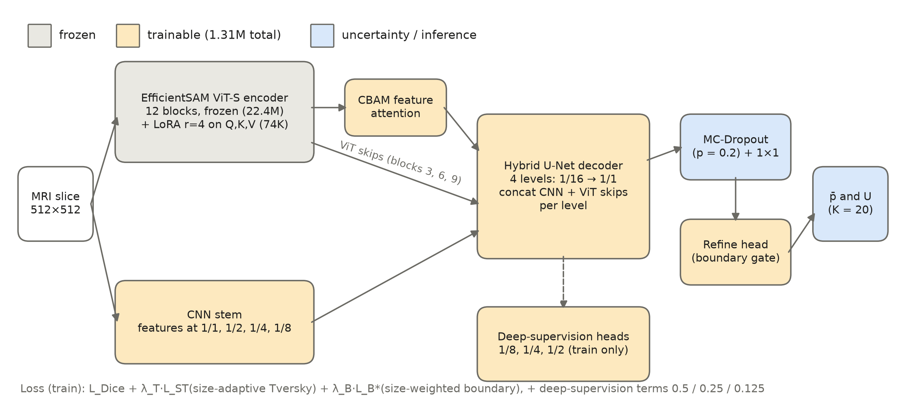

<!--
Authors: Md. Fahim Bin Amin <fahimbinamin@gmail.com>, Israt Jahan Khan <isratjahankhanijk@gmail.com>
-->

# LoRA-EffSAM

[](LICENSE)


Parameter-efficient brain-tumor MRI segmentation with a LoRA-adapted EfficientSAM encoder,
a hybrid CNN–ViT decoder, MC-Dropout uncertainty and explainability analysis.

## Abstract

Foundation segmentation models such as the Segment Anything family are pretrained on
natural images and need adaptation before they work on MRI. We adapt the EfficientSAM
image encoder to brain-tumor segmentation with low-rank adaptation (LoRA) of its
attention layers, keep the encoder frozen otherwise, and add a hybrid CNN–ViT decoder
with skip connections from both a light convolutional stem and intermediate transformer
blocks. Training uses a size-adaptive, boundary-aware loss, and Monte Carlo dropout gives
pixel-wise uncertainty. On the public Figshare brain-tumor dataset (3,064 T1-weighted
contrast-enhanced slices, 233 patients), evaluated on a strict patient-level split with
mean per-image Dice, the final model reaches **0.819 ± 0.003** Dice (3 seeds), and
**0.823 ± 0.003** with flip test-time augmentation, against 0.780 ± 0.006 for a LoRA
baseline (+0.042, paired Wilcoxon p < 0.0001 on 477 test slices). Gains are largest on the
smallest lesions (+0.097) and gliomas (+0.054), while only 1.31 M of 23.7 M parameters
(5.5 %) are trained. An explainability analysis (coarse-to-fine decoder maps, test-time
component knock-outs, uncertainty analysis) shows that the model relies on the LoRA
adapters and the transformer skip connections but hardly on its two attention modules, and
that MC-dropout uncertainty localises boundary ambiguity but does not flag missed tumors.

Full write-up: [`results/`](results/README.md) — method, protocol, results, statistics,
figures and per-run records.

## Pipeline



`src/lora_effsam` is a CLI-driven package: EfficientSAM ViT-S encoder with LoRA on Q/K/V
(frozen otherwise) → CBAM feature attention → hybrid U-Net decoder (CNN-stem skips at
1/1–1/8, transformer skips from blocks 3/6/9, deep supervision) → MC-Dropout head →
boundary-gated refine head. Loss: Dice + size-adaptive Tversky + size-weighted boundary
loss. Evaluation: MC-Dropout (K = 20) with optional flip TTA; analysis tools for paired
statistics, uncertainty and explainability.

### Install

Linux or WSL2 with an NVIDIA GPU (developed on an RTX 3060 12 GB, CUDA 12.6).

```bash
conda create -n lora-effsam python=3.12 && conda activate lora-effsam
pip install torch torchvision --index-url https://download.pytorch.org/whl/cu126
pip install -e ".[dev]"
```

Large artifacts are not in git; the scripts fetch them into gitignored folders:

```bash
bash scripts/fetch_efficientsam.sh   # EfficientSAM code + weights -> third_party/EfficientSAM
bash scripts/setup_data.sh           # Figshare dataset (~830 MB) -> data/figshare_brain_tumor
lora-effsam verify-env                     # GPU, PyTorch, and where data / weights / runs are
```

Locations can be overridden with `LORA_EFFSAM_DATA_DIR`, `LORA_EFFSAM_RUNS_DIR`,
`LORA_EFFSAM_EFFICIENTSAM_DIR` and `LORA_EFFSAM_RESULTS_DIR` (see `src/lora_effsam/paths.py`).

### Run

```bash
SMOKE=1 bash scripts/run_pipeline.sh   # ~5 min: 1-epoch check of the whole pipeline
bash scripts/run_pipeline.sh           # final model, seeds 42/1/2 (~7 h on an RTX 3060)
bash scripts/reproduce_results.sh      # rebuild every table, statistic and figure in results/
```

Single experiments: `bash scripts/run_experiment.sh <name> [lora-effsam train options]` trains,
evaluates and summarises one run into `runs/<name>/` (config, per-epoch metrics, test
results, per-image report, checkpoints); finished runs are never overwritten and
interrupted ones resume. `bash scripts/experiments/run_all_experiments.sh` re-runs all 17
experiments reported in `results/` (~30 h).

### Stages (`lora-effsam <subcommand> --help` for each)

| # | Subcommand | Purpose |
|---|---|---|
| 0 | `verify-env` | Python, PyTorch, CUDA and the data / EfficientSAM / runs locations |
| 1 | `prepare-data` | Figshare `.mat` → PNG + `metadata.csv` with patient IDs (for the patient-level split) |
| 2 | `train` | Train one model; writes `config.json`, `metrics.csv` (every epoch), `test.json` |
| 3 | `evaluate` | MC-Dropout test evaluation (`--tta` for flip TTA), per-image report with image IDs |
| 3 | `visualize` | Input / ground truth / prediction / uncertainty figure |
| 4 | `summarize`, `export-tables` | Run summaries, mean ± SD over seeds, one row per run |
| 4 | `paper-stats` | Paired Wilcoxon tests (Holm), bootstrap CIs, subgroups; learning-curve and subgroup figures |
| 5 | `uncertainty-stats` | Uncertainty by region and lesion size; does uncertainty flag failures (AUROC) |
| 5 | `qualitative-figure` | Rule-selected cases (median per class, small lesion, worst case) |
| 5 | `explainability` | Architecture diagram, internal maps (attention, coarse-to-fine decoder, refine gate, uncertainty) |
| 5 | `knockout` | Test-time component knock-outs of the trained model |
| 5 | `failure-check` | At which decoder level failures are decided |

Every subcommand is a thin wrapper: the same logic is importable from `lora_effsam.data`,
`lora_effsam.models`, `lora_effsam.losses`, `lora_effsam.uncertainty`, `lora_effsam.training`, `lora_effsam.evaluation`
and `lora_effsam.analysis`.

### Results

| Configuration (3 seeds, 477 test slices) | Test Dice | + flip TTA |
|---|---|---|
| Baseline: 256 px, ViT-T, plain decoder | 0.780 ± 0.006 | 0.791 ± 0.007 |
| + full resolution (512 px) | 0.800 ± 0.003 | 0.813 ± 0.005 |
| + intensity augmentation | 0.805 ± 0.003 | 0.814 ± 0.005 |
| **+ ViT-S, hybrid decoder, ViT skips, deep supervision (final)** | **0.819 ± 0.003** | **0.823 ± 0.003** |

Details, statistics and limitations: [`results/03_results.md`](results/03_results.md),
[`results/06_limitations_and_notes.md`](results/06_limitations_and_notes.md).

### Tests

```bash
pytest
```

CPU unit tests always run. Tests that need a CUDA GPU, the EfficientSAM weights, the
dataset or the final model's runs skip themselves when those are missing (the last one
checks that the final model reproduces its recorded test Dice).

## Repository layout

```
src/lora_effsam/  # the pipeline (data, models, losses, uncertainty, training, evaluation, analysis) + CLI
scripts/    # shell entry points: setup, run_pipeline, run_experiment, train_final, reproduce_results
tests/      # pytest suite
results/    # method/results write-ups, figures, tables, statistics,
            # per-run records (checkpoints not included)
data/       # dataset location (downloaded by scripts/setup_data.sh, gitignored)
```

## Citation

If you use this code, please cite our paper (also in [`CITATION.cff`](CITATION.cff)):

```bibtex
@unpublished{amin2026loraeffsam,
  title  = {{LoRA-EffSAM}: Prompt-free brain tumor segmentation with a parameter-efficient {EfficientSAM}},
  author = {Amin, Md. Fahim Bin and Khan, Israt Jahan and Juoairia, Adiba and Alam, Touhid and
            Morol, Md Kishor and Liew, Tze Hui and Nandi, Dip},
  year   = {2026},
  note   = {Code: https://github.com/FahimFBA/LoRA-EffSAM}
}
```

The dataset is from Cheng et al. (Figshare brain-tumor dataset, PLoS ONE 2015 / 2016) and
the encoder from [EfficientSAM](https://github.com/yformer/EfficientSAM); please cite them too.

## Releases

Changes per version are listed in [`CHANGELOG.md`](CHANGELOG.md). Pushing a tag `vX.Y.Z`
publishes a GitHub release from the matching changelog section
(`.github/workflows/release.yml`).

## License

Apache License 2.0, see [`LICENSE`](LICENSE).

## Authors

Md. Fahim Bin Amin (fahimbinamin@gmail.com), Israt Jahan Khan (isratjahankhanijk@gmail.com).
